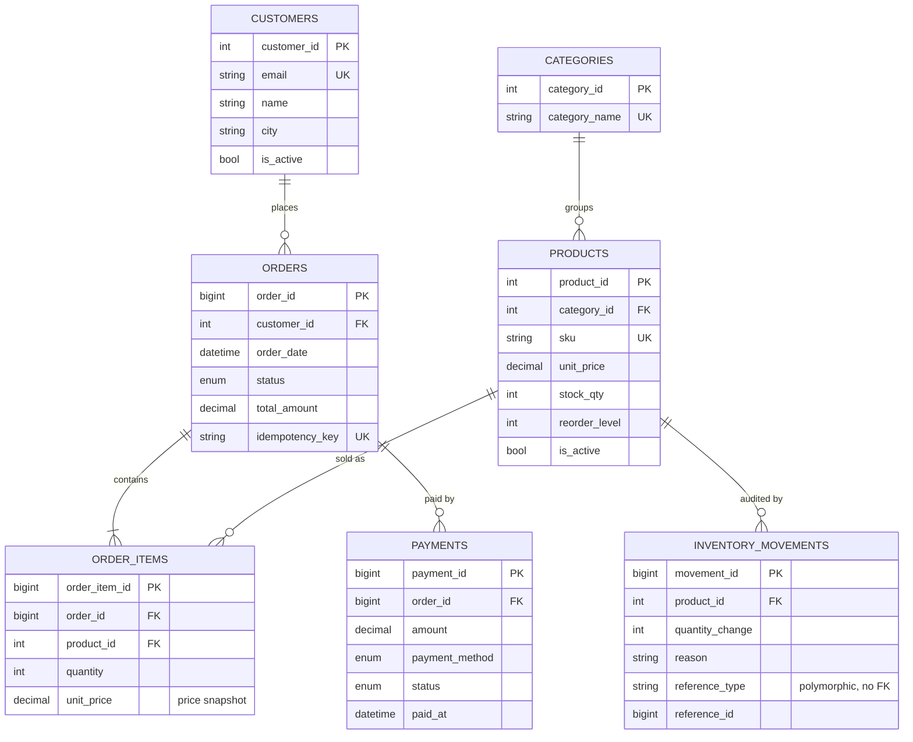

# Entity-relationship diagram

Deletion policy: every foreign key is `ON DELETE RESTRICT`; orders and inventory movements are protected
by triggers. Deactivate (`is_active = 0`) instead of deleting.
